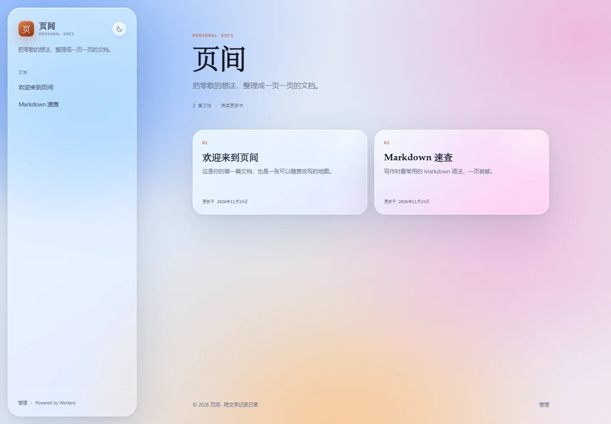
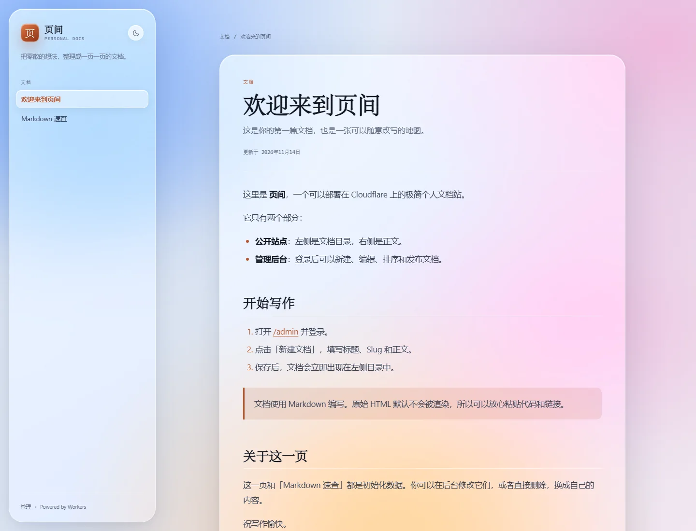
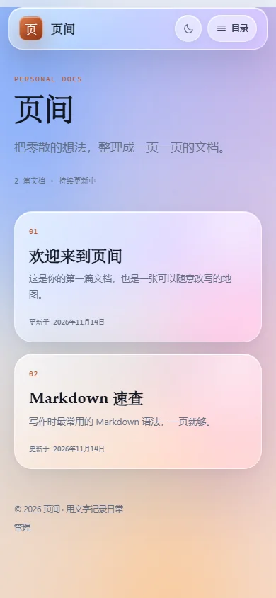
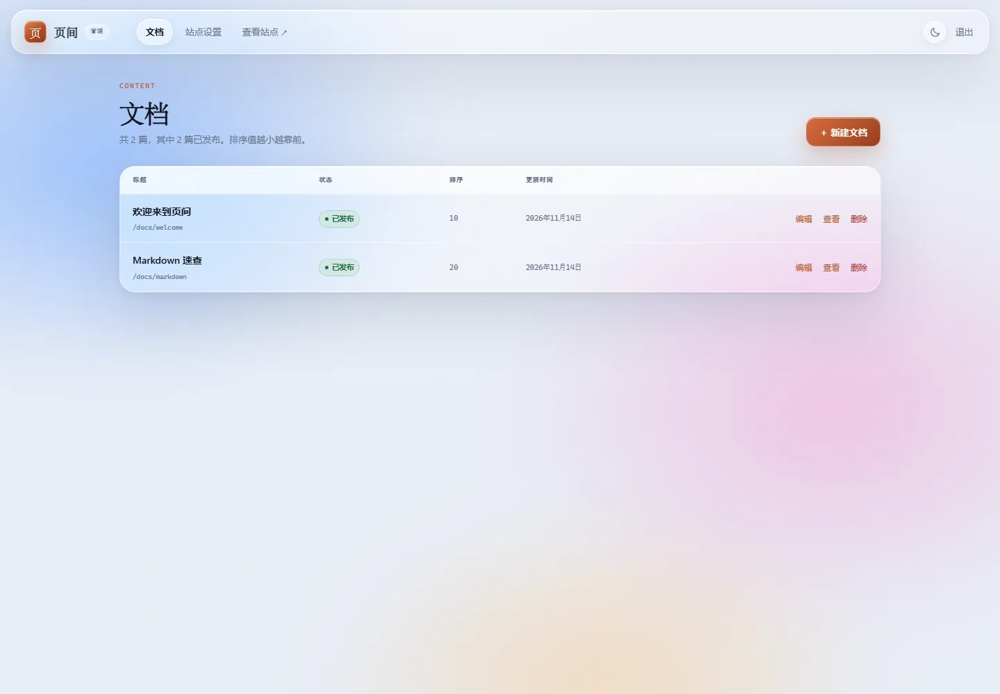
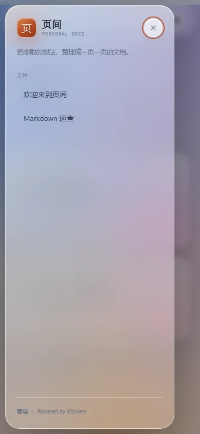
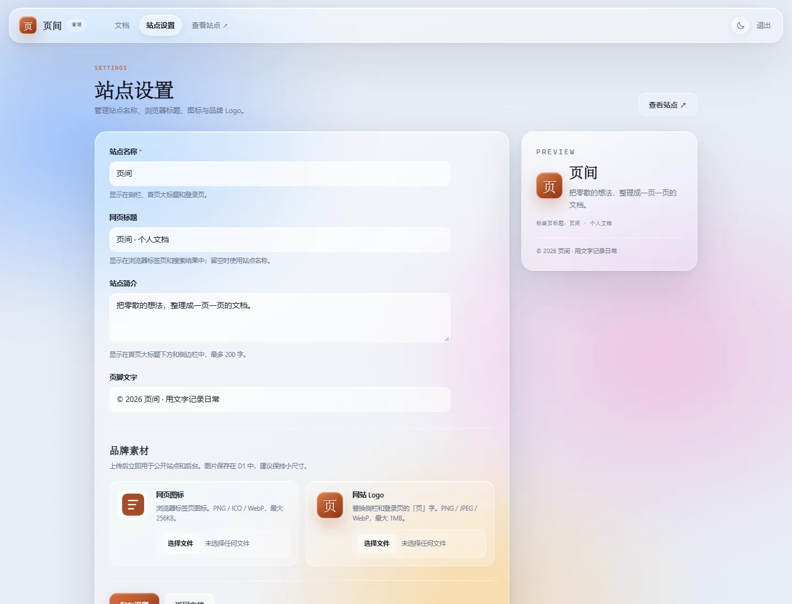

# 页间 · Personal Docs

一个可以部署在 Cloudflare 上的极简个人文档站，带管理员后台。

公开站点负责阅读，后台负责写作。没有多余的功能：文档用 Markdown 编写，保存在 Cloudflare D1 中，登录后即可新建、编辑、排序、发布或删除。









## 功能

- **Liquid Glass 视觉**：分层极光背景、磨砂玻璃面板、镜面高光、细颗粒噪点和悬停光斑；明暗两套主题。
- **公开文档站**：首页文档卡片、侧边栏目录、Markdown 正文、上一篇 / 下一篇。
- **管理员后台**：密码登录、文档 CRUD、草稿与发布、排序、站点名称 / 浏览器标题 / 简介 / 页脚设置，以及网页图标和 Logo 上传。
- **开箱即用**：三条 D1 migration 自动建表并写入两篇示例文档。
- **响应式**：桌面悬浮玻璃侧栏；移动端顶部胶囊栏 + 目录抽屉；后台表格自动切成卡片，编辑器底部固定玻璃保存栏。
- **安全基线**：HttpOnly 会话 Cookie、HMAC 签名、SameSite + Origin 校验、CSP、Markdown 原始 HTML 默认关闭。
- **零外部服务**：不需要数据库服务器、对象存储或第三方登录，只用 Workers、D1 和静态资源。

技术栈：Cloudflare Workers + Workers Assets + D1、[Hono](https://hono.dev/)、[markdown-it](https://github.com/markdown-it/markdown-it)、TypeScript、Wrangler。

## 视觉：Liquid Glass

- 页面背景由多层径向极光和细噪点组成，滚动时保持固定，形成有纵深的“液体”底色。
- 侧栏、文档卡片、阅读面板、后台表格和登录框使用半透明渐变、`backdrop-filter` 模糊、内侧高光和细边框。
- 文档卡片在悬停时光斑产生位移，按钮使用暖橙金属渐变，深色主题下切换为低照度烟雾玻璃。
- 所有玻璃 token 都在 `public/styles.css` 顶部（`--glass*`、`--glow*`、`--page-bg`），改几个变量就能整体换肤。
- 不支持 `backdrop-filter` 的浏览器会自动回退到实色表面；`prefers-reduced-motion` 下关闭背景漂移和悬停位移。

## 响应式布局

| 宽度 | 布局 |
| --- | --- |
| `> 1180px` | 304px 悬浮玻璃侧栏 + 内容区 |
| `861–1180px` | 268px 紧凑侧栏 + 内容区 |
| `≤ 860px` | 吸顶玻璃胶囊栏，文档目录收进侧滑抽屉（支持遮罩、Esc 关闭、焦点回收） |
| `≤ 700px` | 后台文档表格变成玻璃卡片；编辑器显示底部悬浮保存栏；输入框 16px 防止 iOS 自动缩放 |
| `≤ 480px` | 单列卡片、缩小留白；适配超窄屏和刘海安全区 |

所有页面在 320px 起无横向溢出，并适配 `100dvh`、`env(safe-area-inset-*)` 和 `prefers-reduced-motion`。



## 本地开发

要求 Node.js 20+。

```powershell
npm install
Copy-Item .dev.vars.example .dev.vars
npm run db:migrate:local
npm run dev
```

打开 <http://localhost:8787>，后台地址是 <http://localhost:8787/admin>。

仓库工作区里已经带了一份仅用于本地的 `.dev.vars`：

```text
ADMIN_PASSWORD=admin123
SESSION_SECRET=local-development-only-3fbe71a9c4d24f5f
```

如果你重新 clone 或删除了它，请从 `.dev.vars.example` 复制并改成自己的密码。`.dev.vars` 已被 gitignore，不要提交。

常用命令：

| 命令 | 说明 |
| --- | --- |
| `npm run dev` | 启动本地 Wrangler 开发服务器 |
| `npm run typecheck` | TypeScript 类型检查 |
| `npm run check` | 类型检查 + Worker 打包预检 |
| `npm run db:migrate:local` | 对本地 D1 执行 migration |
| `npm run db:migrate:remote` | 对线上 D1 执行 migration |
| `npm run deploy` | 部署 Worker |
| `npm run db:export` | 导出线上数据库到 `backup.sql` |

## 推送到 GitHub

本地目录已经初始化为 Git 仓库（包含一个初始 commit）。在 GitHub 新建**空仓库**后：

```powershell
git remote add origin https://github.com/<你的用户名>/personal-docs.git
git branch -M main
git push -u origin main
```

如果拿到的是 zip 包，解压后可以：

```powershell
git init -b main
git add -A
git commit -m "Initial commit"
git remote add origin https://github.com/<你的用户名>/personal-docs.git
git push -u origin main
```

推送后 GitHub Actions 会自动运行 CI；部署 workflow 需要手动触发，见下文。

## 部署到 Cloudflare

本项目使用 **Cloudflare Workers + Workers Assets**。Workers 和 Pages 同属 Cloudflare 边缘平台；这里选 Workers，是因为 D1 绑定、Worker 路由和静态资源可以在一个部署单元里完成，不需要额外的 Pages Functions 适配层。

### 1. 登录并创建 D1

```powershell
npx wrangler login
npx wrangler d1 create personal-docs
```

命令会输出一段 `[[d1_databases]]` 配置。复制其中的 `database_id`，替换 `wrangler.toml` 里的占位值：

```toml
[[d1_databases]]
binding = "DB"
database_name = "personal-docs"
database_id = "粘贴这里"
migrations_dir = "migrations"
```

也可以在建库时指定区域，例如 `npx wrangler d1 create personal-docs --location=apac`。

### 2. 建表并写入示例数据

```powershell
npm run db:migrate:remote
```

### 3. 配置管理员密码

```powershell
npx wrangler secret put ADMIN_PASSWORD
```

输入一个足够长的随机密码。建议再设置一个独立的会话签名密钥：

```powershell
npx wrangler secret put SESSION_SECRET
```

如果省略 `SESSION_SECRET`，系统会从 `ADMIN_PASSWORD` 派生签名密钥；此时修改密码会让已有会话失效。设置了独立的 `SESSION_SECRET` 后，轮换密码不会自动踢掉旧会话，需要同时轮换 `SESSION_SECRET`。

### 4. 部署

```powershell
npm run deploy
```

部署完成后访问 `https://<你的-worker>.<子域>.workers.dev`，进入 `/admin` 登录。自定义域名可在 Cloudflare 控制台的 Worker → Settings → Domains & Routes 中绑定。

### 5. 用 GitHub Actions 一键部署（可选）

仓库已经包含：

- `.github/workflows/ci.yml`：每次 push / PR 自动跑类型检查和 Worker 打包预检。
- `.github/workflows/deploy.yml`：手动触发，自动执行 D1 migration 并部署 Worker。

把仓库推到 GitHub 后：

1. 打开 GitHub 仓库 → **Settings → Secrets and variables → Actions**。
2. 添加两个 Repository secret：

| Secret | 内容 |
| --- | --- |
| `CLOUDFLARE_API_TOKEN` | Cloudflare API Token，需要 Workers Scripts:Edit、D1:Edit 权限 |
| `CLOUDFLARE_ACCOUNT_ID` | Cloudflare 账户 ID，可在控制台右侧或 Workers 概览页找到 |

3. 确认 `wrangler.toml` 里的 `database_id` 已替换。
4. 打开 **Actions → Deploy → Run workflow**。

工作流会先执行 `npm run db:migrate:remote`，再执行 `npm run deploy`。如果只改了文档内容，通常重新部署即可；新增 migration 时也会自动应用。

也可以在 Cloudflare 控制台使用 **Workers Builds / Connect to Git** 导入同一个仓库，Build command 填 `npm ci`，Deploy command 填 `npm run deploy`，并在 Cloudflare 侧配置 D1 绑定和环境变量。

### 首次部署检查清单

- [ ] `wrangler.toml` 中的 `database_id` 已替换，不再是全零 UUID
- [ ] 已执行 `npm run db:migrate:remote`
- [ ] 已设置 `ADMIN_PASSWORD`，且不是示例密码
- [ ] 建议设置 `SESSION_SECRET`
- [ ] 访问 `/admin` 能登录，首页能看到示例文档

## 后台使用

| 路径 | 作用 |
| --- | --- |
| `/admin/login` | 管理员登录 |
| `/admin/docs` | 文档列表、编辑、查看、删除 |
| `/admin/docs/new` | 新建文档 |
| `/admin/docs/:id/edit` | 编辑文档 |
| `/admin/settings` | 站点名称、网页标题、简介、页脚、图标与 Logo |



品牌设置中：

- **站点名称**用于页面内品牌展示；**网页标题**单独控制浏览器标签页。
- **网页图标**支持 PNG / ICO / WebP，最大 256KB。
- **网站 Logo**替换侧栏和登录页的「页」字，支持 PNG / JPEG / WebP，最大 1MB。
- 勾选「恢复默认」并保存即可删除自定义素材；旧文件会从 D1 中清理。

写作流程：

1. 新建文档，填写标题和正文。
2. `Slug` 是网址的一部分（`/docs/<slug>`），留空会自动生成；只能使用小写字母、数字和连字符。
3. 取消「公开文档」会保存为草稿，草稿只能在后台看到。
4. 「排序」数字越小越靠前，首页和侧边栏都按这个顺序排列。
5. 保存后公开页面立即更新（动态页面设置了 `Cache-Control: no-store`）。

正文支持常用 Markdown：标题、粗体、列表、链接、图片、代码块、引用、表格。原始 HTML 会被转义，避免把脚本注入公开页面。

## 配置

| 名称 | 必需 | 说明 |
| --- | --- | --- |
| `DB` | 是 | D1 绑定，在 `wrangler.toml` 中配置 |
| `ADMIN_PASSWORD` | 是 | 管理员登录密码，线上用 `wrangler secret put` 设置 |
| `SESSION_SECRET` | 否 | 会话 HMAC 密钥；省略时从 `ADMIN_PASSWORD` 派生 |

本地通过 `.dev.vars` 提供这些变量；线上通过 Worker secrets 提供。两者不要混用，`.dev.vars` 不会上传。

## 数据与备份

D1 中有三张表：

- `docs`：`id`、`slug`、`title`、`summary`、`content`、`sort_order`、`published`、时间戳。
- `settings`：站点名称、浏览器标题、简介、页脚，以及当前图标 / Logo 的 asset key。
- `assets`：上传的网页图标和 Logo 二进制数据（key、MIME、大小、BLOB、时间）。

导出线上数据：

```powershell
npm run db:export
```

导出文件为 `backup.sql`，已加入 gitignore。本地导出可以用：

```powershell
npx wrangler d1 export DB --local --output backup-local.sql
```

新增 migration 时，在 `migrations/` 下按编号新建 `.sql` 文件，然后分别执行 `npm run db:migrate:local` 和 `npm run db:migrate:remote`。不要修改已经在线上执行过的 migration。

## 自定义

- **站点文案**：登录后台 → 站点设置，改站点名称、浏览器标题、简介和页脚，不需要改代码。
- **网页图标 / Logo**：站点设置 → 品牌素材。图标支持 PNG / ICO / WebP（最大 256KB），Logo 支持 PNG / JPEG / WebP（最大 1MB），上传后立即生效。
- **品牌颜色与字体**：`public/styles.css` 顶部的 CSS 变量（`--accent`、`--display` 等）同时控制明暗两套主题。
- **示例文档**：`migrations/0002_seed.sql`。新部署会写入两篇示例，后台可以直接修改或删除。

## 项目结构

```text
.
├─ .github/
│  └─ workflows/
│     ├─ ci.yml               # push / PR 类型检查与打包预检
│     └─ deploy.yml           # 手动触发：D1 migration + 部署
├─ migrations/
│  ├─ 0001_init.sql          # docs / settings 表
│  ├─ 0002_seed.sql          # 示例设置与文档
│  └─ 0003_branding.sql      # assets 表与品牌设置
├─ public/
│  ├─ styles.css             # Liquid Glass 样式、明暗主题、响应式
│  ├─ theme.js               # 首屏主题恢复，避免闪烁
│  ├─ app.js                 # 主题切换、导航抽屉、删除确认、编辑器快捷键
│  ├─ favicon.svg
│  └─ robots.txt
├─ src/
│  ├─ index.ts               # Hono 路由、媒体路由、表单处理
│  ├─ auth.ts                # 密码校验、会话签名、CSRF 辅助
│  ├─ db.ts                  # D1 查询与二进制资源
│  ├─ markdown.ts            # Markdown 渲染、标题锚点与链接处理
│  ├─ types.ts
│  ├─ utils.ts
│  └─ views/
│     ├─ layout.ts           # 公开布局、后台布局、登录页
│     ├─ public.ts           # 首页、文档页、404
│     └─ admin.ts            # 文档列表、编辑器、站点设置
├─ scripts/
│  └─ wrangler.mjs           # Wrangler 启动器（将临时目录指向 .tmp）
├─ wrangler.toml
└─ package.json
```

## 安全说明

这是一个轻量个人项目，安全边界按「单管理员、自用」设计：

- 管理员密码只存在于 Worker secret 中，不会写入数据库。登录时对输入和配置值做 SHA-256 摘要并按字节比较，避免明显的时间侧信道。
- 会话是 HMAC-SHA256 签名的 HttpOnly Cookie，默认 7 天；HTTPS 下自动加 `Secure`。
- 所有后台写操作是 POST，并校验 `Origin`；Cookie 使用 `SameSite=Lax`。
- 动态响应带 CSP、`X-Frame-Options: DENY`、`X-Content-Type-Options: nosniff` 等响应头。
- Markdown 关闭原始 HTML，链接协议由 markdown-it 校验。
- SQL 全部使用 prepared statements。
- 品牌上传只接受栅格图片（PNG / ICO / WebP / JPEG），限制文件大小并在独立 `/media/*` 路由中返回；不支持 SVG，避免同源脚本注入。

如果要公开到公网，建议再用 Cloudflare Access 保护 `/admin*`，或在 Cloudflare WAF 中给 `/admin/login` 加速率限制。登录接口本身没有做分布式限流，这是有意的取舍：保持项目零依赖、零外部服务。

## 常见问题

**首页 500 / `no such table: docs`**

没有执行 migration。本地运行 `npm run db:migrate:local`，线上运行 `npm run db:migrate:remote`。

**登录一直提示密码错误**

确认 `.dev.vars` 中的 `ADMIN_PASSWORD` 和输入一致，修改后重启 `npm run dev`。线上用 `npx wrangler secret list` 检查 secret 是否存在。

**忘记线上密码**

重新执行 `npx wrangler secret put ADMIN_PASSWORD` 设置新密码，然后重新登录。如果没设置 `SESSION_SECRET`，旧会话会同时失效。

**Windows 下 workerd 报 `CreateDirectory ... 拒绝访问`**

`npm run dev` 等脚本已经把 Wrangler 的临时目录指到项目内的 `.tmp`。如果你直接调用 `npx wrangler` 遇到这个错误，可以手动指定：

```powershell
New-Item -ItemType Directory -Force .tmp | Out-Null
$env:TEMP = (Resolve-Path .tmp).Path
$env:TMP = $env:TEMP
npx wrangler dev
```

**为什么不用 Pages？**

部署形态是 Workers + Assets。Pages 也能托管这个前端，但项目使用 D1 和 Hono 路由，Workers 的单一入口更直接。若组织强制使用 Pages，需要把 `src/index.ts` 的 `fetch` 挂到 `functions/[[path]].ts`，并在 Pages 项目中绑定 D1；当前仓库没有包含这层适配。
